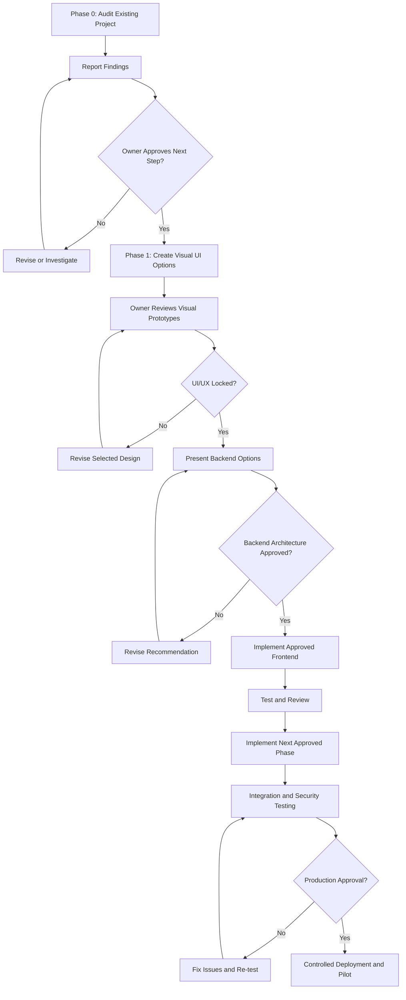
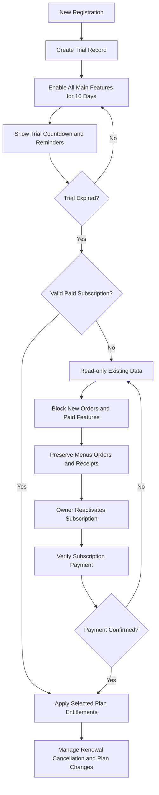
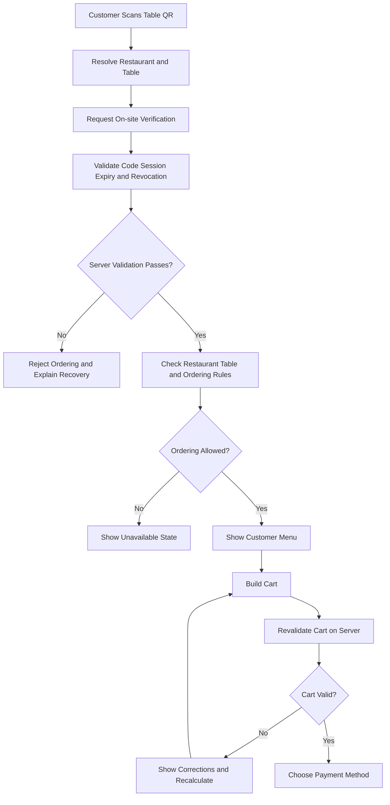
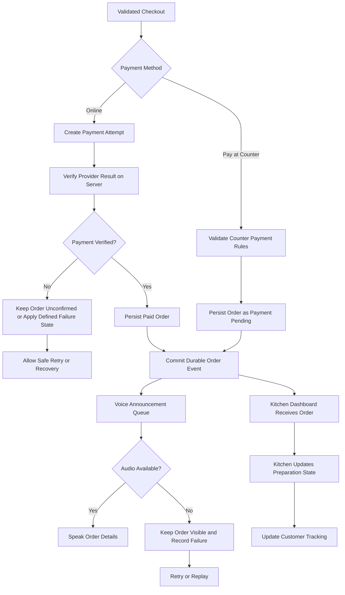
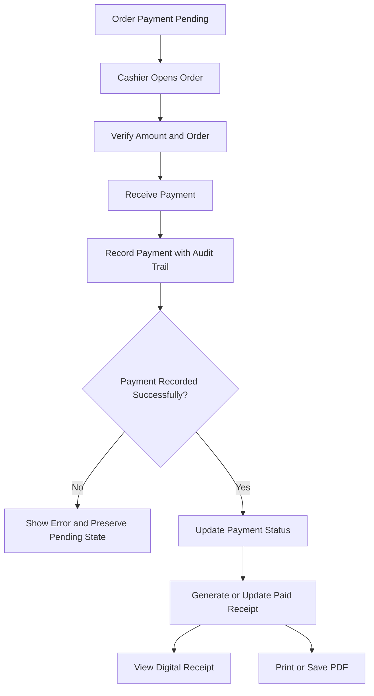
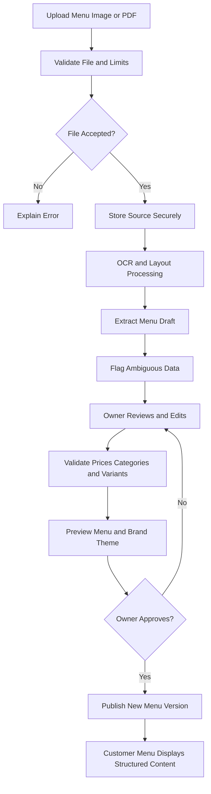
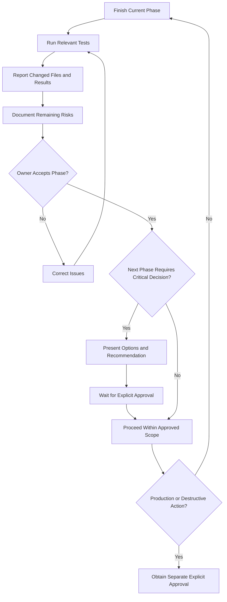

# AutoDine — Required Flowcharts (Part 17)

> **Status: SPECIFICATION ONLY — NOT IMPLEMENTED.**
> These diagrams are the locked product behaviour recorded from the specification. As of 2026-10-18 there is no code implementing any of them (see `docs/PHASE_0_AUDIT.md`). They must be updated only if an approved architecture changes their *implementation*, never to change locked product behaviour.

---

## Flowchart A — Overall development workflow

**Where we are:** at node **C** (Phase 0 report delivered, awaiting approval).

---

## Flowchart B — Trial and subscription lifecycle

**Status:** not implemented. Plan prices locked at ₹899 / ₹1,599 / ₹2,699 per month. Trial = 10 days, all main features, server-side timestamps.

---

## Flowchart C — QR verification and ordering eligibility

**Status:** not implemented. Rotating/short-lived on-site code lifecycle to be designed and presented for approval before implementation.

---

## Flowchart D — Checkout and kitchen notification

**Status:** not implemented. No payment provider selected.

---

## Flowchart E — Counter payment and receipt

**Status:** not implemented.

---

## Flowchart F — AI menu import

**Status:** not implemented. No OCR tooling installed or evaluated. No accuracy measured — none will be claimed until measured.

---

## Flowchart G — Phase approval and release control

**Status:** in effect as the working agreement for this engagement.
