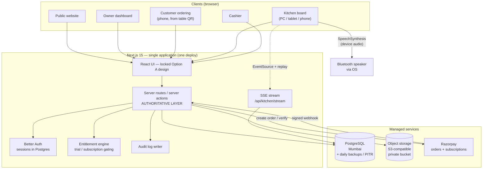

# AutoDine — Phase 6: Backend & architecture options

**Phase:** 6 — Backend and architecture approval
**Status:** Options presented · **awaiting your decision**
**Date:** 2026-10-19 · branch `arena/62c92cc6-new`
**Prerequisite met:** UI/UX locked 2026-10-19 — **Option A, Editorial Minimal** (`docs/DESIGN_SYSTEM.md`)

> Nothing in this document has been built, bought, or activated. No provider account has been created, no card has been entered, no spend has occurred. This is a decision document.

---

## 1. Where we are

Flowchart A has us at node **I — "Present Backend Options"**. The design is locked; the framework is Next.js 15 (your earlier approval). What is *not* decided is where the data lives, how identity works, how the kitchen gets realtime updates, who takes the money, and what it all costs.

**One structural fact from Phase 0 that shapes everything:** there is no backend. The repository was empty four days ago. Every option below is greenfield.

---

## 2. Option A — Keep and extend the existing backend

**Not available.** There is no backend, database, schema, auth layer, or API to keep or extend. I am recording this explicitly because the master plan asks for this option to be evaluated "where appropriate to the existing project" — it is not appropriate here, and I am not going to pretend otherwise by relabelling something else as Option A.

---

## 3. Option B — TypeScript modular monolith + managed Postgres ⭐ RECOMMENDED

One Next.js application, one deployable, one type system, with the database managed by a specialist provider and everything else our own code.

| Layer | Choice |
|---|---|
| Application | Next.js 15 App Router (already approved) — public site, dashboard, customer, kitchen, cashier, and the API in one codebase |
| Database | Managed PostgreSQL. **Preferred: Supabase Postgres in Mumbai (ap-south-1)**; alternative Neon (Singapore) |
| ORM / migrations | Drizzle ORM + `drizzle-kit` — SQL-first, typed, migrations are plain `.sql` files you can read and run anywhere |
| Auth | **Better Auth** — self-hosted, users and sessions live in our own Postgres, organization/membership plugin maps directly to restaurant + staff roles, RBAC and 2FA built in |
| Realtime | Server-Sent Events from our own app, backed by a durable `order_event` table, with polling fallback |
| Storage | S3-compatible object storage (private bucket, signed URLs) |
| Payments | Razorpay — customer payments *and* subscriptions |
| Hosting | One always-on Node service: Render ($7–25/mo) or Railway ($5+ usage) |

**Why this is the recommendation:** the thing that makes AutoDine hard is not CRUD — it is *server-side authority*. Prices, totals, trial/subscription entitlement, QR validity, and payment state must all be enforced where the customer cannot touch them. That needs our own API layer no matter which option we pick. Given we need that layer anyway, buying a platform whose main selling point is *replacing* the API layer buys us less than it appears, while adding vendor-specific concepts (RLS policies, their realtime protocol, their auth tables) that we would have to work around rather than through.

**Cost:** ~$33–60/mo fixed (≈ ₹2,770–5,040 at ~₹84/USD) at launch. See §11.

---

## 4. Option C — Supabase-first managed platform

Supabase provides Postgres **and** Auth **and** Storage **and** Realtime; our Next.js app provides the UI plus a thin authoritative API layer for anything that must not be client-driven.

| Layer | Choice |
|---|---|
| Database / Auth / Storage / Realtime | Supabase Pro — from $25/mo, Mumbai region available |
| Application | Next.js — UI + authoritative server routes for checkout, subscription gating, QR verification, payment recording |
| Tenant isolation | Postgres Row Level Security policies (must be written and reviewed carefully) |
| Payments | Razorpay |
| Hosting | Next.js app on Render/Railway ($7–25/mo) |

**Genuine advantages:** fastest path to a working product. Auth, file storage, and a battle-tested realtime channel are done for us. Mumbai region measured ~5 ms from India [20](https://dev.to/karthiii13/supabase-vs-neon-i-measured-both-free-postgres-tiers-from-india-5da8). Daily backups from day one.

**Genuine disadvantages:** highest lock-in — RLS policies, Supabase Auth's user tables, the Storage API and the Realtime protocol are all Supabase-specific. If we use Supabase Auth, identity is coupled to the vendor; if we use Better Auth against the same database, we are paying for Auth we are not using. And the free tier is **not** production-safe: projects pause after 1 week of inactivity with no backups [1](https://supabase.com/pricing) [2](https://makerkit.dev/blog/saas/supabase-pricing) [7](https://aiagencyplus.com/blog/supabase-free-tier-limits). A restaurant arriving on day eight to a dead app is exactly the failure we cannot ship.

**Cost:** ~$32–55/mo fixed, plus usage overages (egress $0.09/GB, database $0.125/GB, MAU $0.00325 beyond 100k) [6](https://supabase.com/docs/guides/platform/billing-on-supabase).

---

## 5. Option D — Self-hosted monolith on an India VPS

Next.js + PostgreSQL on a single virtual machine in an Indian region (AWS ap-south-1 or an Indian provider), everything self-managed.

**Advantages:** lowest cash cost at ~$12–25/mo; full data residency in India; no vendor terms to negotiate.

**Disadvantages — and why I do not recommend it for v1:** we become the database administrators. We own engine patching, backup scheduling, PITR configuration, restore testing, failover, and monitoring. A single VM is a single point of failure. For a product whose entire promise is *reliability during service*, trading a managed database for ~₹1,000/month saving is the wrong trade at this stage. It becomes reasonable later, at scale, with an ops person.

I include it because it is a legitimate option and because you asked to see the alternatives with real costs — not because I think you should pick it.

---

## 6. Side-by-side

| | **B — Monolith + managed Postgres** ⭐ | **C — Supabase platform** | **D — Self-hosted VPS** |
|---|---|---|---|
| Time to working product | Medium | **Fastest** | Slowest |
| Ops burden | Low–medium | **Lowest** | **Highest** |
| Control over server authority | **Full** | Full (we write the API layer anyway) | Full |
| Vendor lock-in | **Low** | High | **Lowest** |
| India latency | ~5 ms (Supabase Mumbai) | **~5 ms** | ~5 ms |
| Backups / PITR | Provider-managed | Provider-managed | **We own it** |
| Monthly cost (launch) | $33–60 | $32–55 + overages | **$12–25** |
| Free tier usable for dev | **Yes** | Yes | n/a |
| Free tier usable for production | **No** | **No** | n/a |
| Best if | You want control without owning a database | You want the shortest path to launch | You have ops capacity and want the lowest spend |

---

## 7. Recommendation

**Choose Option B.** Concretely: Next.js 15 + Drizzle + **Supabase Postgres (Mumbai) as a managed database only** + Better Auth + our own SSE realtime + S3-compatible storage + Razorpay, on a single always-on Node host.

Three reasons, in order:
1. **The hard part is ours regardless.** Checkout validation, entitlement enforcement, QR verification and payment reconciliation cannot be delegated to a generated REST API. Once we accept that we own an API layer, Option C's main advantage shrinks.
2. **Lock-in where it costs least.** Postgres, Drizzle SQL, and Better Auth are all portable, open, and boring. Supabase's RLS, Auth tables, Storage API and Realtime protocol are not — and RLS in particular is a security control we would be trusting with tenant isolation, where a single miswritten policy is a cross-restaurant data leak.
3. **Cost is comparable.** Options B and C land within a few dollars of each other. There is no financial argument for taking on the lock-in.

The one thing Option C does better is speed to a working realtime channel — and I think our SSE approach (§10) closes most of that gap for about a day's work, while giving us the exact durability guarantee the specification demands.

---

## 8. System diagram (for Option B)

Note what is deliberately **absent**: no Redis, no queue service, no Kubernetes, no microservice boundaries, no separate realtime vendor. One process, one database.

---

## 9. Data model (initial sketch, Option B)

Entities mapped from Part 15 of the specification. Types assume PostgreSQL.

| Entity | Key fields and constraints |
|---|---|
| `user` | id, email (unique), phone (E.164), `password_hash`, name, timestamps |
| `restaurant` | id, name, slug (unique), `timezone` (IANA), `currency` (char 3), address, legal fields, theme JSONB |
| `membership` | id, `user_id`, `restaurant_id`, role ∈ {owner, manager, kitchen, cashier}, status · unique(user_id, restaurant_id) |
| `menu`, `menu_version`, `category`, `item` | versioned; `item` carries availability, veg flag, image key |
| `variant`, `modifier_group`, `modifier` | prices as minor units; groups typed single/multi + required |
| `table` | id, restaurant_id, code, label, seats, `ordering_enabled` |
| `qr_code` | id, table_id, `public_id`, status ∈ {active, printed, revoked, disabled}, rotated_at, revoked_at |
| `verification_session` | id, restaurant_id, table_id, `code_hash` (**never the raw code**), expires_at, state |
| `order` | id, restaurant_id, table_id, code, `state` (prep), `payment_state` (separate), placed_at, `currency`, totals snapshot |
| `order_item` | **immutable snapshot**: name, unit_price, qty, variant, modifiers JSONB, tax lines |
| `payment` | id, order_id, provider, `provider_ref`, amount, state, method, `recorded_by`, recorded_at |
| `receipt` | id, order_id, number (unique), snapshot JSONB, issued_at |
| `order_event` | id, restaurant_id, order_id, type, payload, created_at, **consumed flag** — the durable event log |
| `announcement_job` | id, `order_event_id`, status, attempts, last_error — non-authoritative |
| `subscription` | id, restaurant_id, plan, state, `trial_started_at`, `trial_ends_at`, period_end, provider_ref |
| `billing_event` | id, `provider_event_id` **UNIQUE** (idempotency), payload, processed_at |
| `audit_log` | id, restaurant_id, actor_user_id, action, entity, entity_id, before/after JSONB, at |

**Rules that are non-negotiable in the schema:**
- Money is `bigint` minor units (paise) + a currency code. Never floats, never strings.
- All timestamps are `timestamptz` stored UTC; display converts using the restaurant's IANA zone.
- Orders and receipts store **snapshots** — editing a menu can never change history.
- Preparation state and payment state are separate columns with separate state machines.
- Idempotency is enforced by the database (unique indexes), not by application hope.

---

## 10. The eleven things I was asked to explain

### 10.1 Compatibility with the existing application
Greenfield. Next.js 15 is already approved and running (the prototype is a Next.js app). Option B extends exactly what exists rather than replacing it. Zero rewrite risk.

### 10.2 Initial and recurring costs
See §11. Short version: **~$33–60/mo (₹2,770–5,040) fixed**, plus Razorpay's ~2.36% of transaction value. There is no one-off build cost beyond my time.

### 10.3 Authentication and tenant isolation
- **Better Auth**, self-hosted: sessions and users in our Postgres, so identity is ours and exportable. It has an organization/membership plugin that maps directly onto restaurant + staff roles, plus RBAC and 2FA [1](https://supastarter.dev/blog/better-auth-vs-nextauth-vs-clerk) [5](https://starterpick.com/guides/best-boilerplates-using-better-auth-2026).
- **Why not Auth.js / NextAuth:** v5 is still beta (5.0.0-beta.32) and has been in security-patch-only maintenance since September 2025; both projects are now maintained by the Better Auth team, whose own guidance is to use Better Auth for new projects [15](https://github.com/nextauthjs/next-auth) [13](https://startwithidentity.com/vendors/open-source/authjs/) [11](https://kostra.io/blog/best-authjs-nextjs-starter-kits-2026). Starting a new product on a maintenance-mode library is an avoidable risk.
- **Tenant isolation:** every request resolves actor → memberships → restaurant scope. Data access goes through repository functions that *require* a `restaurantId`; there is no raw table access from route handlers. If we land on Supabase Postgres, RLS is added as a second line of defence, never as the only one.
- **Roles:** owner (everything + billing + staff), manager (orders, menu, reports), kitchen (board + prep state only), cashier (payments + receipts).

### 10.4 Database and migration approach
Drizzle ORM with checked-in `.sql` migrations, applied by CI. Rules: additive-first (expand/contract), no destructive migration without a verified backup and a tested rollback, run against staging first, and a written note of what each migration does. Since this is greenfield there is **no data to migrate today** — the risk is entirely future schema change, which is why the rules go in now.

### 10.5 Realtime and kitchen reliability
- Orders are written to Postgres; an `order_event` row is committed **in the same transaction**. If the announcement dies, the order is already on the board — the database is authoritative, audio is not.
- The kitchen board subscribes via **SSE** (`EventSource`), which reconnects automatically. On reconnect the client sends `Last-Event-ID` and receives anything it missed via the durable event table. Heartbeat every 25 s.
- **Fallback:** if SSE fails, the board polls every 5 s. Either way the board reflects the database, so a reconnection can never lose an order.
- **Announcement dedupe:** each event has a stable id; the client tracks the last id it spoke; reconnect replays from there. `announcement_job` rows record attempts and failures for the replay/recovery UI.
- Single instance for v1, so no fan-out bus is needed. If we ever scale out, add Postgres `LISTEN/NOTIFY` or Redis pub/sub — a contained change behind the same interface.
- **I cannot promise exactly-once audio.** Browser autoplay policy, muted devices, sleeping tabs and OS audio routing are outside our control. What I can promise: no order is ever lost, every failure is recorded, and every missed announcement is replayable. That matches the spec's requirement and I will keep stating it this way rather than claiming more.

### 10.6 File storage and OCR compatibility
- Uploads go to an S3-compatible private bucket; served via short-lived signed URLs. Content-type and magic-byte validation, size and page-count limits, EXIF stripping, image variants generated with `sharp`. Uploads are never served from the app origin as executable content.
- **OCR / AI menu import is deferred, deliberately.** Tesseract and PaddleOCR are CPU- and memory-hungry; they will not run reliably on a 512 MB–1 GB instance, and they are the one feature that could take the whole service down during a rush. Plan: ship manual menu entry (plus CSV import) first, then evaluate OCR in Phase 12 on a bigger instance or a separate worker, with a **measured** accuracy report before any claim is made. **No AI or OCR provider is being introduced now, and no restaurant data will be sent to any external AI service without your explicit approval.**

### 10.7 Payment webhook support
- **Razorpay** for customer payments and for subscriptions. It is the natural choice for India: ~2% platform fee + 18% GST (≈2.36% effective), ₹0 setup, ₹0 annual maintenance, no lock-in, and a 0%-platform-fee window for new merchants activated on or after 1 July 2026 (90 days or ₹5 lakh GMV, whichever comes first) [1](https://razorpay.com/blog/razorpay-payment-gateway-pricing-explained/) [7](https://razorpay.com/blog/cheapest-payment-gateway-in-india/) [16](https://razorpay.com/blog/razorpay-0-percent-platform-fee-offer-90-days-new-merchants-2026/). Razorpay Subscriptions supports UPI AutoPay — the RBI-approved route for recurring UPI mandates — plus recurring cards and dunning retries [15](https://rajeshrnair.com/blog/software/custom-software/best-payment-gateway-india-2026-razorpay-payu-ccavenue.html).
- **One cost change to be aware of:** from 15 October 2026, merchant UPI payments above ₹2,000 carry a 0.4% MDR capped at ₹300, on top of the gateway platform fee [9](https://upimdrcalculator.com/payment-gateway-charges/) [12](https://claudecms.com/news/india-ecommerce-payment-processing-fees-compared/). Most restaurant tickets sit under ₹2,000, so the impact is small, but it is real.
- **UPI AutoPay mandate costs:** roughly ₹7 one-time registration plus ₹4–15 per mandate per quarter depending on volume [18](https://www.reddit.com/r/indianstartups/comments/1m7z1d3/charges_for_upi_autopay_is_very_high_on/) — about ₹1.50/month on a ₹899 plan. Acceptable, but I am flagging it rather than burying it.
- **Verification model:** we never trust the browser. Payment is confirmed by signature-verified webhook **plus** a server-side status fetch. Webhooks are idempotent via a unique `provider_event_id`. A redirect to a success page proves nothing.
- **I have not verified the current RBI e-mandate rules** (pre-debit notification, additional factor authentication) against Razorpay's live subscription flow. That gets checked before subscriptions go live, not assumed.

### 10.8 Backup and recovery
Managed Postgres daily backups, with PITR enabled on the paid tier (Supabase Pro includes daily backups; PITR is a paid add-on. Neon Launch offers up to 7 days' PITR at $0.20/GB-month [2](https://vela.run/articles/neon-serverless-postgres-pricing-2026/)). Plus weekly encrypted logical dumps to object storage, and a **restore drill** — an untested backup is not a backup. Proposed targets for your confirmation: RPO ≤ 24 h (≤ minutes with PITR), RTO ≤ 4 h.

### 10.9 Local development
`docker compose up -d db` for Postgres 16, or a Neon branch. `.env.example` is committed; `.env` is gitignored (already in place). Commands: `npm run dev`, `db:generate`, `db:migrate`, `db:seed`, `typecheck`, `test`, `lint`. A seeded demo restaurant means a new developer is running in one command.

### 10.10 International expansion
- Money: minor units + currency code, so a second currency is data, not a migration.
- Tax: stored as labelled tax lines with jurisdiction — **not** a hard-coded GST column. (This matters right now: the locked pricing is in INR and the tax treatment is still undecided.)
- Time: UTC storage + per-restaurant IANA timezone.
- Phones: E.164 from day one.
- Payments: Razorpay behind a `PaymentProvider` interface so a second provider can be added per-market.
- Copy: externalised strings. Note for later — India's DPDP rules require privacy notices in English **and** the 22 languages listed in the Eighth Schedule where requested [5](https://kryptomindz.com/guides/dpdp-act-india-compliance-guide/), which is a real localisation cost for a public product.
- **Not** building multi-currency UI or i18n now. Just refusing to paint ourselves into a corner.

### 10.11 Vendor lock-in and exit strategy
| Dependency | Lock-in | Exit |
|---|---|---|
| PostgreSQL | None — it is Postgres | `pg_dump` → restore anywhere |
| Drizzle | None — output is plain SQL | Remove the ORM, keep the schema |
| Better Auth | None — users live in our tables | Export rows; swap the library |
| S3-compatible storage | Low — S3 API is a de facto standard | Point at another S3 endpoint |
| SSE | None — plain HTTP | Replace the transport, keep the event log |
| Razorpay | **Medium** — India-specific, holds subscriptions and mandates | Abstracted behind an interface; mandates would need re-registration. This is the one dependency I would accept as strategic. |
| Host (Render/Railway) | Low — it runs `npm start` | Move the container |

### 10.12 Security responsibilities (added)
| Us | Provider |
|---|---|
| Authorization, tenant isolation, input validation, rate limiting, CSRF, session handling, secret management, webhook signature verification, audit logging, dependency patching, backup verification, incident response | Host and DB engine patching, TLS, storage IAM, physical security. Razorpay carries PCI DSS scope for card data — **we never touch card numbers.** |

**India regulatory note:** the DPDP Rules are being phased in — Consent Manager provisions from 13 November 2026 and full substantive compliance (notice, consent, security safeguards, breach reporting, retention/erasure, data-principal rights) by **13 May 2027**, with penalties up to ₹250 crore for failure to implement reasonable security safeguards [3](https://www.syslabs.in/blog/dpdp-act-2026-compliance-guide-india) [9](https://www.softwaresuggest.com/blog/dpdp-act/) [5](https://kryptomindz.com/guides/dpdp-act-india-compliance-guide/). Practical consequences for us: capture consent properly if we collect a customer's name or phone at checkout, publish a plain-language privacy notice, keep ~1 year of audit logs, and have a breach runbook (notify the Board and affected people without delay, detailed report within 72 hours). **This is not legal advice** — I recommend a lawyer reviews the privacy notice and consent flow before launch, and I will flag it again at the right phase rather than quietly deciding it.

---

## 11. Cost table

FX assumption: **₹84 ≈ US$1** (varies — treat INR figures as indicative).

### Fixed monthly infrastructure (Option B)

| Item | Provider / size | USD/mo | ≈ INR/mo |
|---|---|---|---|
| Application host (always-on Node) | Render Starter $7 (512 MB) or Standard $25 (2 GB) · Railway Hobby $5 + usage | $7–25 | ₹590–2,100 |
| Managed PostgreSQL | Supabase Pro $25 (Mumbai, 8 GB disk, daily backups) **or** Neon Launch (~$15–19 light use) | $15–25 | ₹1,260–2,100 |
| Object storage | R2/S3 — small at launch | $0–5 | ₹0–420 |
| Domain, transactional email | *Not yet chosen — I will bring you options before committing* | TBC | TBC |
| **Total fixed** | | **$33–60** | **₹2,770–5,040** |

Reference pricing: Render [1](https://render.com/pricing) [3](https://temps.sh/blog/render-pricing-2026) · Railway [1](https://docs.railway.com/pricing/plans) [3](https://temps.sh/blog/railway-pricing-2026) · Supabase [1](https://supabase.com/pricing) · Neon [2](https://vela.run/articles/neon-serverless-postgres-pricing-2026/).

### Variable (per transaction)

| Item | Rate |
|---|---|
| Razorpay platform fee | ~2% + 18% GST on the fee ≈ **2.36%** of transaction value |
| UPI MDR (from 15 Oct 2026) | 0.4% on merchant UPI above ₹2,000, capped ₹300 |
| UPI AutoPay mandate (subscriptions) | ~₹7 one-time + ₹4–15 per mandate per quarter |

**Sanity check on unit economics:** ten restaurants on an average ₹1,400/month = ₹14,000 revenue. Against that: ~₹3,500 infrastructure + ≈₹330 gateway fees. The model works, and it works before we have hundreds of customers.

### Free tiers — the honest version

You asked for free-first, but not at the cost of reliability. Here is what "free" actually gets us:

| Tier | Limitation | Production-safe? |
|---|---|---|
| Render free | Web service **sleeps after 15 min idle** (~1 min wake); 750 instance-hours/mo; **free Postgres expires 30 days after creation and is deleted after a 14-day grace period** [2](https://livemy.app/blog/render-pricing) [8](https://render.com/articles/how-much-does-cloud-application-hosting-cost-for-small-businesses) | **No** |
| Railway free | $1 monthly credit; ~0.5 GB RAM per service cap [3](https://temps.sh/blog/railway-pricing-2026) | **No** |
| Supabase free | 500 MB DB; **project pauses after 1 week idle**; no backups; 2 projects [1](https://supabase.com/pricing) [7](https://aiagencyplus.com/blog/supabase-free-tier-limits) | **No** |
| Neon free | 1 GB/project (raised 1 Oct 2026), 20 GB account, 100 CU-hours/project/mo, scales to zero after 5 min, **no India region** [3](https://neon.com/docs/introduction/plans) [6](https://agentdeals.dev/vendor/neon) | Dev/staging only |

**Conclusion: there is no free configuration that meets the reliability requirement.** A kitchen board that sleeps is a broken product. Free tiers are excellent for development and staging, and I will use them that way. Production needs the ~$25–45/mo floor (≈ ₹2,100–3,800/mo). **I am asking your approval for that recurring spend before incurring it.**

---

## 12. Migration plan (greenfield)

No data exists, so there is nothing to migrate. The plan is for the schema build and for every future change:

| Stage | Scope |
|---|---|
| **A** | Identity, restaurants, memberships, roles, menus, categories, items, variants, modifiers, tables, QR codes, verification sessions |
| **B** | Orders, order-item snapshots, payments, receipts, order events, announcement jobs |
| **C** | Subscriptions, billing events, entitlement enforcement, audit logging |
| **D** | Brand themes, menu versions/rollback, exports, reporting rollups |

**Standing rules:** additive-first; every migration has a written description and either a down-migration or an explicit restore-from-backup path; never drop a column in the same release that stops writing it; apply to staging first; **take a verified backup immediately before any production migration**; no destructive migration runs without your explicit go-ahead.

---

## 13. What I am explicitly NOT doing

| Not doing | Why |
|---|---|
| Creating any provider account or entering payment details | Rule 3 — needs your explicit approval |
| Activating Razorpay (even in test mode) | Paid service; test-mode keys only once you say so |
| Choosing a domain or email provider | A cost decision I will bring to you with options |
| Introducing any AI/OCR dependency | Phase 12, with a measured evaluation first |
| Starting the production backend build | Blocked on your decision in §14 |
| Changing anything in the locked UI | Locked means locked |

---

## 14. Decisions I need from you

1. **Architecture: Option B, C, or D?** (recommendation: **B**)
2. **Approve the production infrastructure floor** of roughly $25–45/mo (₹2,100–3,800) once we are ready to pilot — while I keep development and staging on free tiers until then?
3. **May I start building the locked frontend (Phase 7) in parallel**, as static screens against mock data, while you decide the backend? The master plan says not to block safe design work on an unapproved technology choice, and the locked design is independent of where Postgres lives. Nothing built this way would commit us to any vendor.
4. **What should happen to the rejected prototype directions (B and C)?** They are currently untouched in the repository as recorded alternatives.
